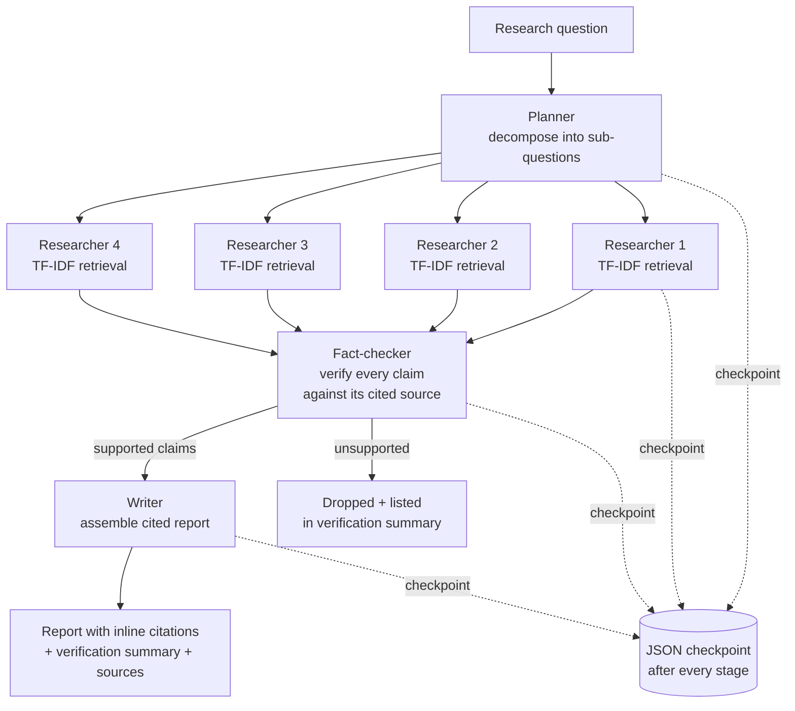

# agent-research-pipeline

Ask a single LLM to "research X" and you get a confident essay with invented citations. The citations *look* real — that's the problem. Production research needs decomposition: split the question, gather evidence per sub-question, check every claim against its source, and only then write — with a paper trail for every sentence.

This repo is that pipeline, built as a multi-agent system on **Google ADK**: a planner decomposes the question, parallel researchers gather evidence from a source corpus, a fact-checker verifies every claim against the source it cites, and the writer only ships supported claims with inline citations. Unsupported claims are dropped (or explicitly marked `[unverified]`) — never silently kept.

Mock-first: the full pipeline runs offline with no API key and no network, against a bundled corpus of 22 synthetic source documents. Live mode swaps the planner and claim-drafting steps to real Gemini calls; retrieval, verification, and assembly stay deterministic code either way.

## How it works



Stages (each checkpointed, each retried on transient failure, each recorded in the ledger):

1. **Plan** — decompose the question into focused sub-questions. Mock: deterministic facet rules by question type (decision / effect / informational). Live: planner LLM, parsed by code with rule fallback.
2. **Research** — fan-out: one retrieval worker per sub-question (thread pool) over the bundled corpus (pure-Python TF-IDF, title-weighted, deterministic ranking). Fan-in in plan order.
3. **Claims** — turn evidence into claims, each citing a source id. Mock: best-matching sentences per source. Live: writer LLM drafts claims ending in `[source-id]`; lines citing unknown ids are discarded by the parser.
4. **Fact-check** — the gate. A claim is supported only if its content words substantially overlap its cited source's text (≥ 0.5) **and** every number in the claim appears in that source. No LLM judgment involved.
5. **Write** — assemble the report: supported claims grouped by sub-question with inline `[source-id]` citations, a verification summary (checked / supported / dropped, with reasons), and a sources list.

## Quickstart

```bash
make install     # venv + editable install (mock mode: no key, no network after install)
make test        # 50 tests, all offline
make demo        # full run + injected-failure retry + crash/resume + ADK loop
make eval        # 3 bundled eval cases
```

Or directly:

```bash
research-pipeline "Should a typical homeowner install rooftop solar panels?"
research-pipeline "How does remote work affect employee productivity and wellbeing?"
research-pipeline --resume "..."     # continue from research_checkpoint.json
research-pipeline --agent "..."      # run via the ADK agent composition
```

Optional live mode (real Gemini model for decomposition and claim drafting):

```bash
pip install -e ".[live]"
export GEMINI_API_KEY=...            # GEMINI_MODEL overrides the model (default gemini-3.5-flash-lite)
research-pipeline --live "What should a first-time buyer know before purchasing an electric vehicle?"
```

Live mode is verified against the Gemini free tier
(`gemini-3.5-flash-lite`): the planner decomposed the solar question
into five specific sub-questions (financing, incentives, benefits,
risks, site requirements), 30 drafted claims were checked against
their cited sources (30 supported, 0 dropped), and the ledger
recorded real per-stage tokens/latencies (~3,700 tokens, ~35s total).
One honest imperfection: lexical retrieval surfaced an EV-range
document under the risks section — correctly cited and verified,
just off-topic; that's the documented TF-IDF limitation.

## Why Google ADK

Planner → parallel researchers → fact-checker → writer is exactly ADK's composition model: a `SequentialAgent` chains the stages, a `ParallelAgent` fans the researchers out, and each role is an `LlmAgent` with a behavior-only prompt and typed function tools over the same deterministic pipeline the CLI runs. State passes between stages via `output_key` + instruction templating. The mock/live split is one constructor argument: roles run on a deterministic `ScriptedLlm` by default and on a real Gemini model with `live=True` — tools, retrieval, and the fact-check gate don't change.

## Production patterns

- **Claim-level fact-checking with citations** — verification is deterministic text analysis (token overlap + number containment), so the gate's decisions are reproducible and testable. The mock claim extractor deliberately mis-cites two claims (verifier-checked swap) to prove the gate catches real mis-citations, the classic LLM failure mode.
- **Checkpoint/resume** — full pipeline state is written to a JSON checkpoint after every stage, atomically (tmp file + rename, so a crash never leaves a torn file). `--resume` skips completed stages. The demo crashes after the research stage and resumes to a byte-identical report.
- **Per-stage retries** — transient failures (rate limits, timeouts) retry with exponential backoff, capped attempts; every attempt is ledgered. `inject_failure` makes the research stage fail once so the retry path is provable in the demo and tests.
- **Cost/token ledger** — per-stage attempts, tokens, latency, and estimated cost in JSONL, with a run summary. Mock tokens are estimated (~1.33/word); live tokens come from API usage metadata where reported.
- **Evals** — 3 bundled questions with expected decomposition facets and must-cite sources. The eval runner checks decomposition coverage, citation precision (every citation resolves — must be 1.0), and unsupported-claim rate in final reports (must be 0).
- **Thread safety** — parallel researchers share an in-memory evidence dict written under a lock; the corpus and TF-IDF index are read-only after construction. No SQLite anywhere; state is JSON.

## What's real vs mocked

| Piece | Mock mode (default) | Live mode |
|---|---|---|
| Agent composition | Real ADK `SequentialAgent`/`ParallelAgent`/`LlmAgent` loop on a deterministic `ScriptedLlm` | Same composition on a real Gemini model |
| Decomposition | Deterministic facet rules by question type | Planner LLM → JSON, parsed by code, rule fallback |
| Sources | Bundled corpus of 22 synthetic documents (ids, titles, factual sentences) | Same local corpus (no web retrieval) |
| Retrieval | Pure-Python TF-IDF, title-weighted, deterministic | Identical |
| Claim drafting | Best-matching evidence sentences, 2 per source | Writer LLM drafts `[source-id]`-cited claims; unknown ids discarded |
| Fact-check gate | Deterministic: token overlap ≥ 0.5 + all claim numbers present in source | Identical |
| Mis-citation proof | Two claims deterministically mis-cited (verifier-checked) so the gate has something real to catch | Real LLM mis-citations caught the same way |
| Tokens/cost | Estimates (~1.33 tokens/word, flash-lite-class price table) | API usage metadata where reported; costs still estimates |
| Latency | Measured wall-clock per stage | Measured wall-clock per stage |

Known limitations: verification is lexical — a paraphrase that changes vocabulary heavily can fail the overlap check, and a claim can pass overlap while subtly distorting meaning (the numbers check catches the most dangerous distortions). Retrieval quality is bounded by the small synthetic corpus. Live decomposition/claim quality depends on the model; both are parsed defensively with deterministic fallbacks.

## Layout

```
src/agent_research_pipeline/
  prompts.py        behavior-only system prompts per role + live-mode templates
  decomposition.py  facet rules (mock) + live-output parser
  corpus.py         bundled corpus loader (data/corpus.json, 22 docs)
  retrieval.py      TF-IDF index, sentence ranking
  claims.py         claim extraction + citation verification (the gate)
  report.py         report assembly + report claim parser (for evals)
  ledger.py         per-stage token/cost/latency ledger (JSONL)
  pipeline.py       stages, fan-out, checkpoint/resume, retries
  live.py           google-genai calls for live plan/draft steps
  tools.py          typed ADK tools over the pipeline
  mock_llm.py       ScriptedLlm for the offline ADK loop
  agent.py          ResearchAgent class + ADK composition (Sequential/Parallel/Llm agents)
  evals.py          bundled eval runner (data/evals.json)
  demo.py           one-command demo (run + crash/resume + ADK loop)
  cli.py            research-pipeline CLI
tests/              50 offline tests
```

Apache-2.0.
